# Verbal analysis and talk figures — review packet

Prepared September 20, 2026 on `verbal-analysis-talk-builds`, based on `9617b39e0d545242aa52992a32beaac58c42d336`. This packet accompanies the working-branch plotting update. Main is not merged or changed; the delivery message records the pushed commit. This new reconstructed descriptive workflow does not recover the original analysis scripts or establish scientific handoff acceptance.

## Main comparison figure

[Full PNG](../../figures/study_comparison_baseline_change/baseline_change_full.png) · [PDF](../../figures/study_comparison_baseline_change/baseline_change_full.pdf) · [Exact plotted values](../../figures/study_comparison_baseline_change/baseline_change_plotted_means.csv) · [Builds 00–04](../../figures/study_comparison_baseline_change/builds/)

For each age, measure and role, the two curves are **Study 2 Intentional − Study 1 baseline** and **Study 2 Accidental − Study 1 baseline**. The eight panels separate roles into rows and measures into columns. Zero represents the baseline; values are percentage-point changes labeled as percentages. The axis is `Change from baseline (%)`, from -50% to 50%; all observed means fit, and four interval ends beyond the limits are truncated at the panel boundary without arrows. The 128-row CSV saves both source means, both Ns, each difference and its interval without display rounding. Raw Yes-response figures remain backups.

Participant bootstraps independently resample Study 1 and each Study 2 condition, reusing the same baseline draw for both contrasts. The pointwise 95% intervals therefore include uncertainty in both source means. These are between-study descriptive differences, not within-person change or an isolated causal estimate. Study 2 adults remain the selected pilot comparison, and the child samples remain uncapped snapshots.

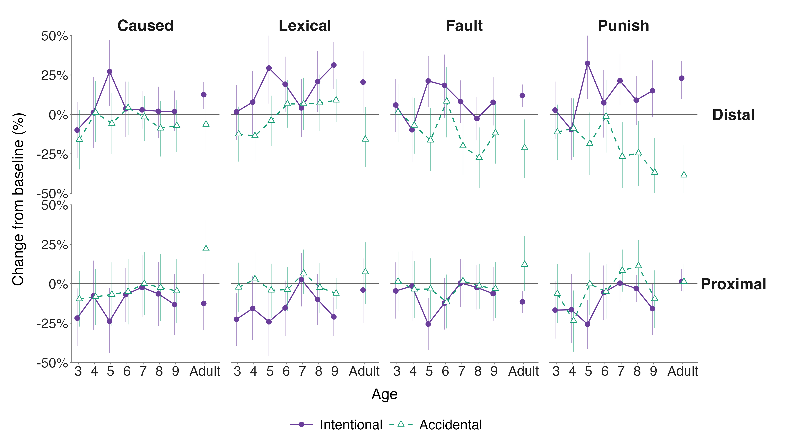

## Age-pooled Study 2 Distal-minus-Proximal gap summary

[PNG](../../figures/study_comparison_baseline_change/study2_distal_proximal_gap_summary.png) · [PDF](../../figures/study_comparison_baseline_change/study2_distal_proximal_gap_summary.pdf) · [Exact eight gaps, paired Ns, source means and CIs](../../figures/study_comparison_baseline_change/study2_distal_proximal_gap_summary_values.csv)

Study 2 children aged 3–9 are pooled within condition: 206 Intentional and 200 Accidental; the adult pilot is excluded. Average available scenarios within each child × role × measure, then compute that child's Distal-minus-Proximal difference. Each plotted value is the mean of those paired differences, multiplied by 100. Both/neither remain included. All current children have both role means for every measure. Participants receive equal weights within condition; unequal age composition is not adjusted.

The single panel uses purple filled circles and teal open triangles, with a neutral connector only within each measure and a zero reference. Negative gaps favor Proximal. The 95% intervals resample whole children within condition, preserving paired roles and all four measures together. The source means and paired Ns are in the CSV.

Intentional has a more positive gap for every measure. The between-condition separation is greatest for Punish (+39.60 percentage points), followed by Lexical (+27.95), Fault (+22.88) and Caused (+16.20). Thus punishment shows the clearest widening; fault does not exceed lexical attribution. These pointwise intervals do not establish formal differences between measures.

The previous two-panel condition-mean summary and its CSV are replaced. The baseline-change figure retains simple boundary clipping without CI arrows. Its structure, means and interval calculations are unchanged.

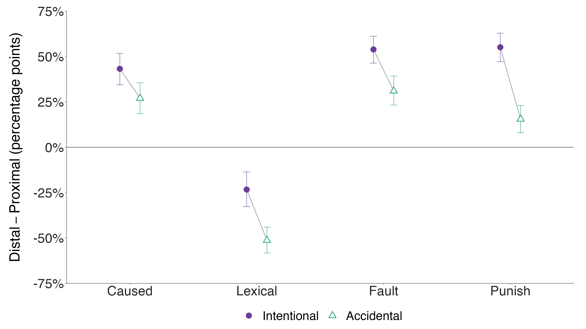

## Single Cause adult and child comparison

[Full developmental PNG](../../figures/single_cause/talk/single_cause_yes_responses_full.png) · [PDF](../../figures/single_cause/talk/single_cause_yes_responses_full.pdf) · [Full-precision child/adult means, Ns and CIs](../../figures/single_cause/talk/single_cause_developmental_values.csv)

[Pooled child summary PNG](../../figures/single_cause/talk/single_cause_intentionality_summary.png) · [PDF](../../figures/single_cause/talk/single_cause_intentionality_summary.pdf) · [Pooled means and CIs](../../figures/single_cause/talk/single_cause_intentionality_summary_values.csv)

**Inclusion flow:** 970 raw rows → 97 sessions / 97 unique children → exclude one withdrawn session → 96 included children (50 Intentional, 46 Accidental). There are **zero repeat child IDs**. All 194 warmup rows are omitted from scientific summaries; the 96 retained children contribute 768 test rows and 384 participant-by-measure means. `completed` (False throughout) and `included_in_summary` never filter participants. Inclusion respects `include_in_analysis`, withdrawal/exclusion flags and `true_completion_status`, with actual response rows audited separately.

**Additional export quirk:** both exported test-count fields say 2, although every session has eight substantive test answers. The Rmd counts the actual Bike/Mirror answers and records the discrepancy; the raw fields are not changed. The export's meaning for those two count fields is unverified.

The table gives every plotted child mean in percent, rounded to six decimals, with the common N for each row's four measures. Both scenarios are available for every retained child and measure. The CSV contains full precision and the bootstrap bounds.

| Age | Condition | N | Caused | Lexical | Fault | Punish |
| --- | --- | ---: | ---: | ---: | ---: | ---: |
| 3 | Intentional | 14 | 53.571429% | 78.571429% | 78.571429% | 57.142857% |
| 3 | Accidental | 12 | 54.166667% | 91.666667% | 58.333333% | 54.166667% |
| 4 | Intentional | 10 | 75.000000% | 85.000000% | 65.000000% | 65.000000% |
| 4 | Accidental | 14 | 42.857143% | 92.857143% | 78.571429% | 60.714286% |
| 5 | Intentional | 13 | 92.307692% | 80.769231% | 84.615385% | 84.615385% |
| 5 | Accidental | 10 | 45.000000% | 85.000000% | 55.000000% | 45.000000% |
| 6 | Intentional | 13 | 92.307692% | 88.461538% | 88.461538% | 76.923077% |
| 6 | Accidental | 10 | 45.000000% | 90.000000% | 45.000000% | 30.000000% |

**Adult working sample: N=32, 16 per condition.** The recovered CSV has 32 unique complete adults, all with blank error fields. The historical notes and slide report N=30 (15 per condition), but no defensible rule identifying two exclusions was recovered. As explicitly requested for this revision, all 32 enter the current working Adult endpoint. No source rows are removed or altered and no exclusions are inferred from old plot heights. This does not reconstruct the unidentified historical N=30 subset; see the [source-by-source adult audit](../../docs/single_cause/adults/ANALYSIS_AUDIT.md).

| Adult condition | N | Caused | Lexical | Fault | Punish |
| --- | ---: | ---: | ---: | ---: | ---: |
| Intentional | 16 | 96.875% | 96.875% | 93.750% | 93.750% |
| Accidental | 16 | 87.500% | 96.875% | 56.250% | 3.125% |

These adult means average Bike/Mirror within each participant before averaging across participants. Every measure uses all 16 adults in its condition; their bootstrap bounds are in the developmental-values CSV. Adults are shown separately from the child lines and are not pooled into either child summary.

The developmental figure has four panels, ages 3–6 plus the Adult endpoint (16 per condition), a 0–100% Yes axis, the same dashed 50% reference line as Study 2 and the exact shared Intentional/Accidental colors. The pooled children-only summary gives equal weight to participants within condition and connects only the two condition means within each measure. Historical Single Cause figures and lab-deck images remain unchanged. Exact historical child-figure provenance and deployment revision remain unverified.

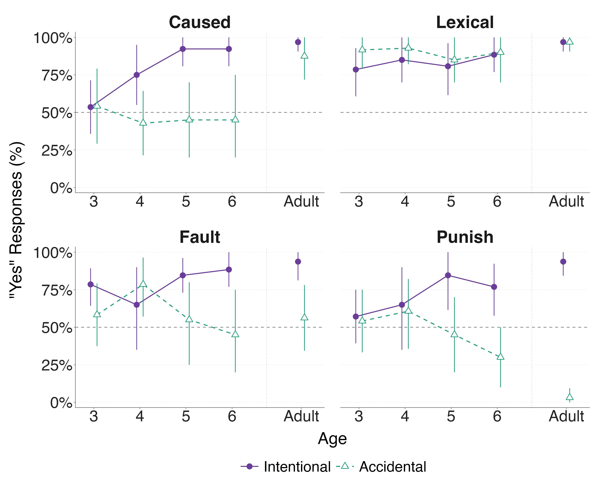

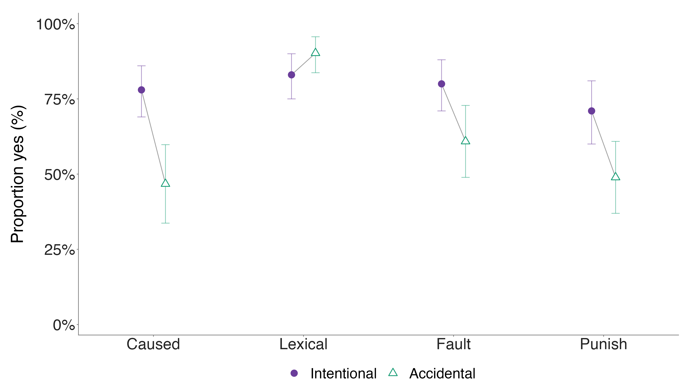

### Requested Single Cause build previews

All 17 builds use fixed axes, panel geometry, legend placement and margins. Each measure adds Intentional adults → Intentional children → Accidental adults → Accidental children. Previously revealed points and intervals do not move.

Build 00:

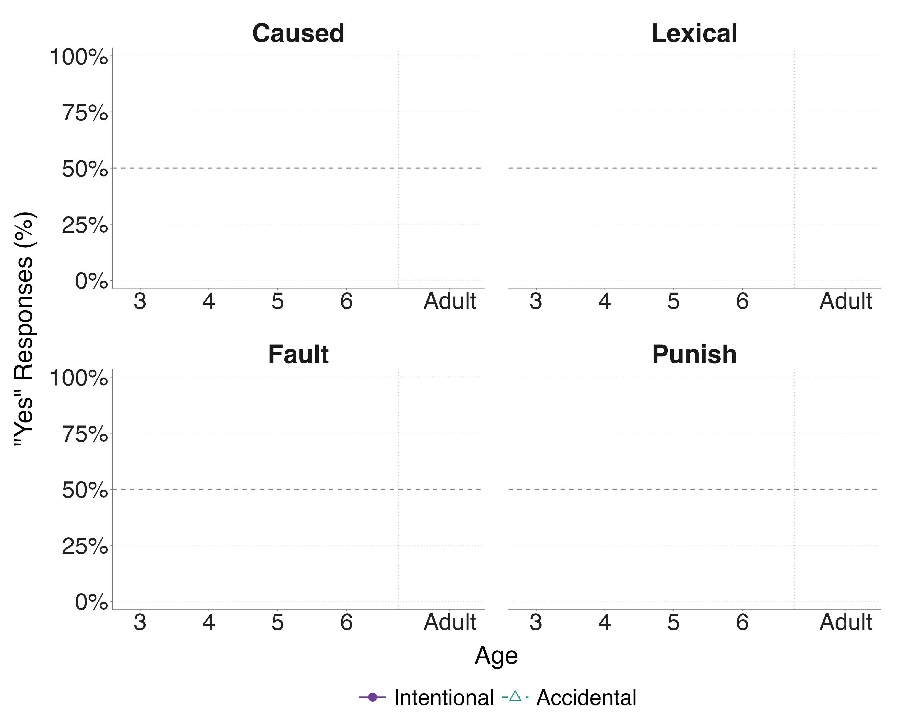

Build 04:

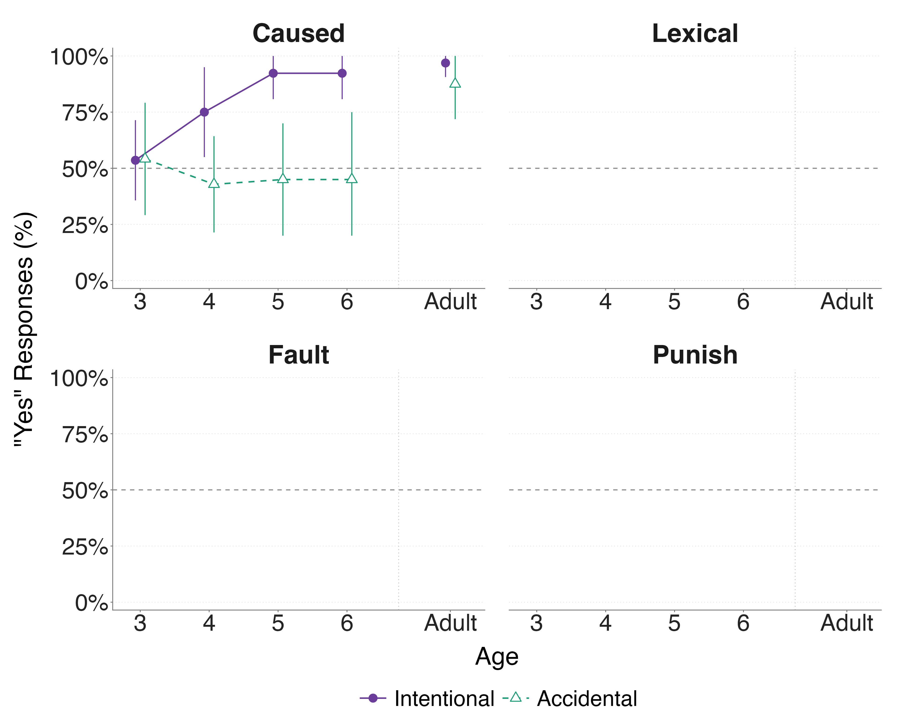

Build 08:

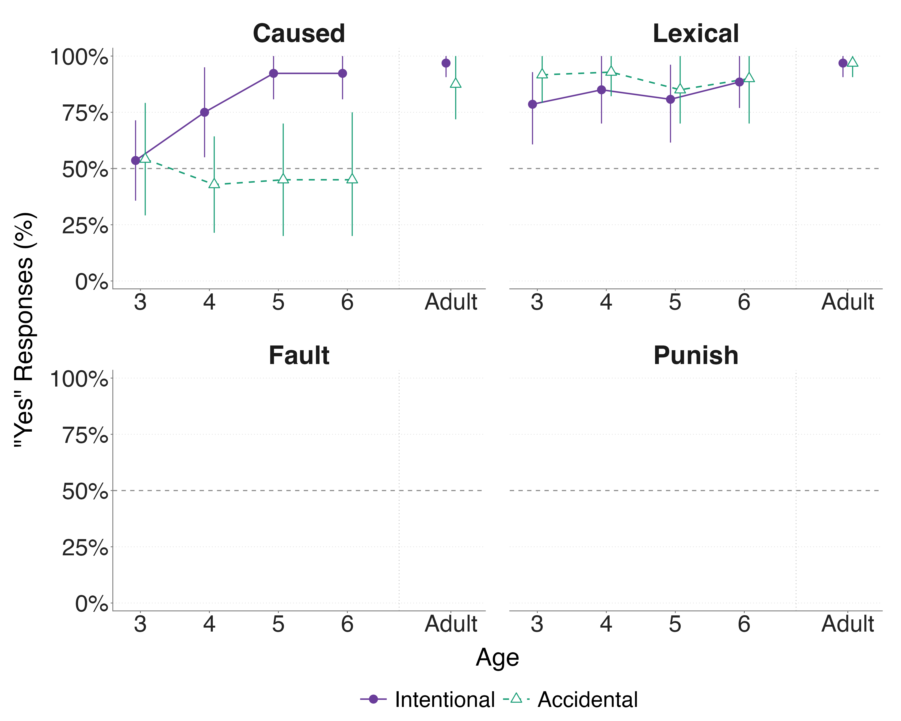

Build 12:

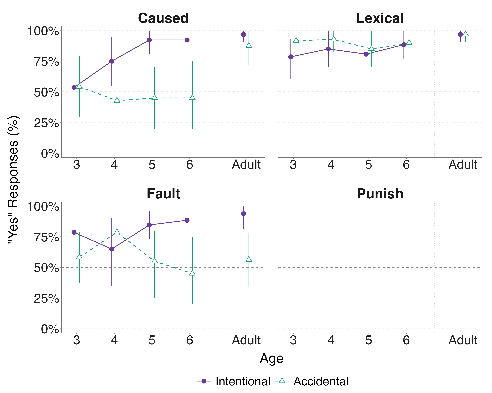

Build 16:


## Cross-study synthesis: intention effects in a common child age range

[PNG](../../figures/study_comparison/study2_singlecause_intention_effect_comparison.png) · [Vector PDF](../../figures/study_comparison/study2_singlecause_intention_effect_comparison.pdf) · [Full-precision effects, CIs, source proportions and Ns](../../figures/study_comparison/study2_singlecause_intention_effect_comparison_values.csv)

**Sample choice for review:** children aged 3–6 in both studies. Single Cause contributes 50 Intentional and 46 Accidental children; Study 2 contributes 107 Intentional and 116 Accidental children. Adults remain in the developmental endpoints, and Study 1 is not part of this intention-effect comparison. The shared age range was selected to avoid confounding the comparison with Study 2's additional ages 7–9. Age composition within 3–6 is still not standardized. Each participant receives equal weight within study and condition.

Yes=1, No=0, with available scenarios averaged within participant × measure (and role in Study 2). The plotted effect is **100 × (Intentional mean Yes − Accidental mean Yes)**. Conditions are between participants, so effects are differences of condition means, not within-person condition differences. The 5,000-draw participant bootstrap independently samples each study/condition and preserves all measures/roles together for each participant. Intervals include uncertainty in both condition means; they are pointwise 95% percentile intervals, not corrected tests of differences between structures or measures.

The grouped point-range plot has twelve points, no connecting lines and a zero reference. Study 2 Distal uses the existing red `#E41A1C`, Study 2 Proximal the existing blue `#377EB8`, and Single Cause gray `#666666`. Marker shapes also distinguish structures. All estimates and interval ends fit the range.

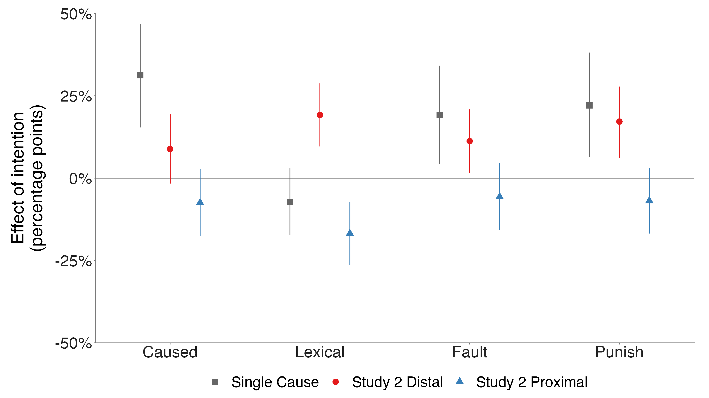

Values below are percentage points, rounded to six decimals for reading. The linked CSV preserves full numeric precision. Ns are the same across measures within each structure.

| Measure | Structure | Intentional N | Accidental N | Effect (pp) | 95% CI (pp) |
| --- | --- | ---: | ---: | ---: | --- |
| Caused | Single Cause | 50 | 46 | 31.260870 | [15.391304, 46.869565] |
| Caused | Study 2 Distal | 107 | 116 | 8.846278 | [-1.648505, 19.372382] |
| Caused | Study 2 Proximal | 107 | 116 | -7.484692 | [-17.616923, 2.682888] |
| Lexical | Single Cause | 50 | 46 | -7.217391 | [-17.219565, 2.956522] |
| Lexical | Study 2 Distal | 107 | 116 | 19.215276 | [9.619723, 28.775479] |
| Lexical | Study 2 Proximal | 107 | 116 | -16.842572 | [-26.401869, -7.174509] |
| Fault | Single Cause | 50 | 46 | 19.130435 | [4.260870, 34.173913] |
| Fault | Study 2 Distal | 107 | 116 | 11.255237 | [1.553940, 20.883016] |
| Fault | Study 2 Proximal | 107 | 116 | -5.688044 | [-15.674448, 4.515791] |
| Punish | Single Cause | 50 | 46 | 22.086957 | [6.304348, 38.133696] |
| Punish | Study 2 Distal | 107 | 116 | 17.176926 | [6.111022, 27.811795] |
| Punish | Study 2 Proximal | 107 | 116 | -6.912665 | [-16.831292, 2.969707] |

In this matched-age sample, Single Cause has the largest positive point estimate for Caused (31.26 pp), Fault (19.13) and Punish (22.09). Study 2 Distal is positive across all four measures, with Lexical (19.22) slightly larger than Punish (17.18). Study 2 Proximal is negative across measures; its Lexical effect (−16.84, CI [−26.40, −7.17]) is clearly away from zero in the pointwise interval. Its other intervals include zero, which does not establish equivalence or absence of an effect. Thus the plot does **not** show uniformly strongest effects for Distal, uniformly near-zero Proximal effects, or Punish as the unique standout. Comparisons across structures/measures remain descriptive and do not isolate causal structure from cohort or age-composition differences.

## Developmental-stage syntheses

These are additional raw-endorsement figures. The earlier intention-effect backup, baseline-change figure and all other current figure families remain available. No relative-attribution score is used.

Stages are children **3 or 4**, children **5 or 6**, and **Adults**. Ages 7–9 remain in the original developmental figures. Average available Bike/Mirror answers within participant first, then average participants with equal weight within each study/stage/condition. One missing scenario would leave the available answer; both missing would omit only that participant's measure/role mean. All current displayed scores have both scenarios. Pointwise 95% intervals resample participant means 5,000 times. Shared endpoints reuse exactly the same summary and CI in the new figures. Condition connectors join group means from different participants; they do not indicate within-person condition changes.

| Source / condition | Ages 3–4 N | Ages 5–6 N | Adults N |
| --- | ---: | ---: | ---: |
| Study 1 Baseline | 63 | 59 | 100 |
| Study 2 Intentional | 60 | 47 | 20 |
| Study 2 Accidental | 67 | 49 | 21 |
| Single Cause Intentional | 24 | 26 | 16 |
| Single Cause Accidental | 26 | 20 | 16 |

Source datasets are exp4, exp6 and exp7 for children; `chains_baseline_full_run-responses.csv` for Study 1 adults; the selected earlier `exp2_new_pilot-responses.csv` for Study 2 adults; and `single_cause_pilot1-responses.csv` for all 32 Single Cause adults. Source links and the adult historical N=30 audit are in the [Rmd](causal_verbs.Rmd) and [comparison guide](../../figures/study_comparison/README.md). Study 2's preregistered main adult dataset remains missing. The stages are separate cohorts with unequal within-stage age composition, so the summaries do not establish longitudinal change or isolate causal structure from other study differences.

Tables give **mean percentage [95% CI], N** for each endpoint, rounded to three decimals. The linked CSVs preserve full precision, proportions and percentages, source study, eligible Ns and contributing Ns. Every plotted endpoint is listed.

### Punishment by causal target

[PNG](../../figures/study_comparison/punishment_causal_structure_intention.png) · [PDF](../../figures/study_comparison/punishment_causal_structure_intention.pdf) · [Exact means, Ns and CIs](../../figures/study_comparison/punishment_causal_structure_intention_values.csv)

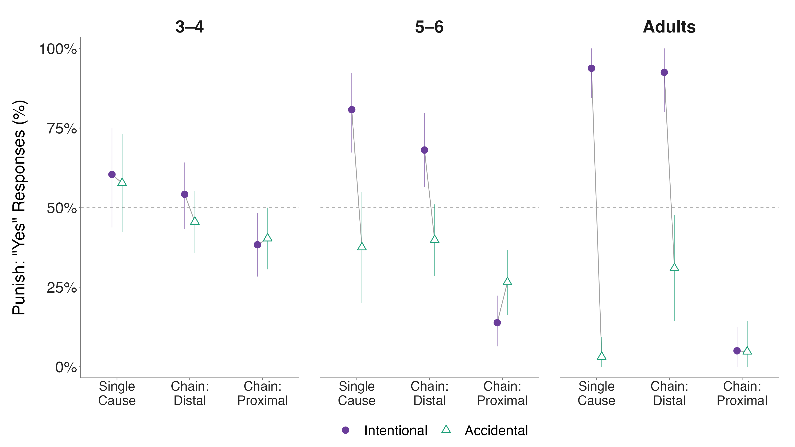

| Stage | Target | Intentional: mean [CI], N | Accidental: mean [CI], N |
| --- | --- | --- | --- |
| 3–4 | Single Cause | 60.417 [43.750, 75.000], 24 | 57.692 [42.308, 73.077], 26 |
| 3–4 | Chain: Distal | 54.167 [43.333, 64.167], 60 | 45.522 [35.821, 55.224], 67 |
| 3–4 | Chain: Proximal | 38.333 [28.333, 48.333], 60 | 40.299 [30.597, 50.000], 67 |
| 5–6 | Single Cause | 80.769 [67.308, 92.308], 26 | 37.500 [20.000, 55.000], 20 |
| 5–6 | Chain: Distal | 68.085 [56.383, 79.787], 47 | 39.796 [28.571, 51.020], 49 |
| 5–6 | Chain: Proximal | 13.830 [6.383, 22.340], 47 | 26.531 [16.327, 36.735], 49 |
| Adults | Single Cause | 93.750 [84.375, 100.000], 16 | 3.125 [0.000, 9.375], 16 |
| Adults | Chain: Distal | 92.500 [80.000, 100.000], 20 | 30.952 [14.286, 47.619], 21 |
| Adults | Chain: Proximal | 5.000 [0.000, 12.500], 20 | 4.762 [0.000, 14.286], 21 |

For Single Cause and Distal, the condition varies the judged person's own intention; **for Proximal it varies the distal person's intention**. Intentional-minus-Accidental punishment gaps are small at 3–4 (Single Cause 2.72 pp; Distal 8.64), larger at 5–6 (43.27; 28.29), and large in the adult samples (90.63; 61.55). Proximal changes are −1.97, −12.70 and 0.24 pp across the three stages. These descriptive differences have not been tested as developmental interactions.

### Single Cause: what changes when intention changes?

[PNG](../../figures/study_comparison/single_cause_intention_dumbbells.png) · [PDF](../../figures/study_comparison/single_cause_intention_dumbbells.pdf) · [Exact means, Ns and CIs](../../figures/study_comparison/single_cause_intention_dumbbells_values.csv)

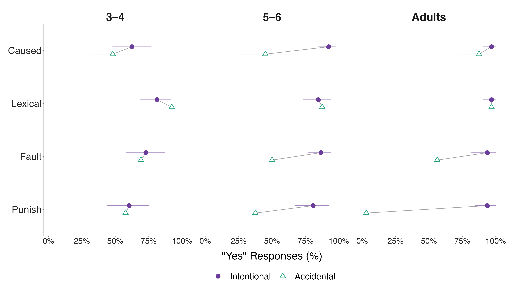

| Stage | Measure | Intentional: mean [CI], N | Accidental: mean [CI], N |
| --- | --- | --- | --- |
| 3–4 | Caused | 62.500 [47.917, 77.083], 24 | 48.077 [30.769, 65.385], 26 |
| 3–4 | Lexical | 81.250 [68.750, 91.667], 24 | 92.308 [84.615, 98.077], 26 |
| 3–4 | Fault | 72.917 [58.333, 87.500], 24 | 69.231 [53.846, 84.615], 26 |
| 3–4 | Punish | 60.417 [43.750, 75.000], 24 | 57.692 [42.308, 73.077], 26 |
| 5–6 | Caused | 92.308 [84.615, 98.077], 26 | 45.000 [25.000, 65.000], 20 |
| 5–6 | Lexical | 84.615 [73.077, 94.231], 26 | 87.500 [75.000, 97.500], 20 |
| 5–6 | Fault | 86.538 [76.923, 94.231], 26 | 50.000 [30.000, 70.000], 20 |
| 5–6 | Punish | 80.769 [67.308, 92.308], 26 | 37.500 [20.000, 55.000], 20 |
| Adults | Caused | 96.875 [90.625, 100.000], 16 | 87.500 [71.875, 100.000], 16 |
| Adults | Lexical | 96.875 [90.625, 100.000], 16 | 96.875 [90.625, 100.000], 16 |
| Adults | Fault | 93.750 [81.250, 100.000], 16 | 56.250 [34.375, 78.125], 16 |
| Adults | Punish | 93.750 [84.375, 100.000], 16 | 3.125 [0.000, 9.375], 16 |

The 5–6 and adult samples separate strongly for Fault and Punish, while adult Lexical means are identical (96.875%) and the 5–6 Lexical gap is small (−2.88 pp). Caused also changes substantially at 5–6 (47.31 pp), so the pattern is not exclusive to moral judgments. At 3–4, Lexical is higher under Accidental by 11.06 pp; stability should not be asserted uniformly across ages.

### Caused and Lexical role mapping

[PNG](../../figures/study_comparison/caused_lexical_role_mapping.png) · [PDF](../../figures/study_comparison/caused_lexical_role_mapping.pdf) · [Exact means, Ns and CIs](../../figures/study_comparison/caused_lexical_role_mapping_values.csv)

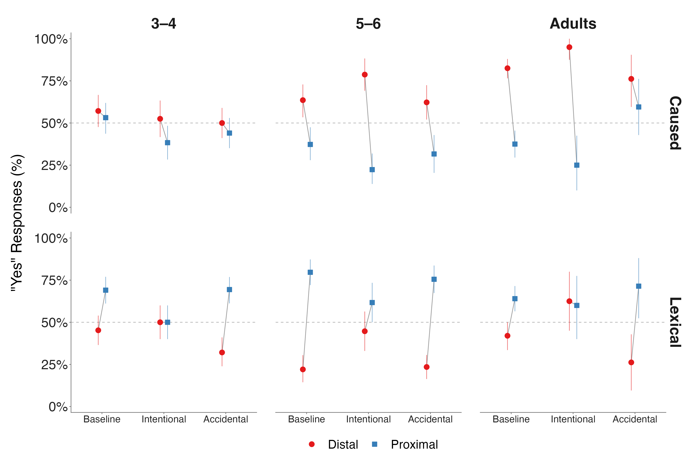

| Measure | Stage | Condition | Distal: mean [CI], N | Proximal: mean [CI], N |
| --- | --- | --- | --- | --- |
| Caused | 3–4 | Baseline | 57.143 [47.619, 66.667], 63 | 53.175 [43.651, 61.905], 63 |
| Caused | 3–4 | Intentional | 52.500 [41.667, 63.333], 60 | 38.333 [28.333, 48.333], 60 |
| Caused | 3–4 | Accidental | 50.000 [41.045, 58.955], 67 | 44.030 [35.075, 52.985], 67 |
| Caused | 5–6 | Baseline | 63.559 [53.390, 72.881], 59 | 37.288 [27.945, 47.458], 59 |
| Caused | 5–6 | Intentional | 78.723 [69.149, 88.298], 47 | 22.340 [13.830, 31.915], 47 |
| Caused | 5–6 | Accidental | 62.245 [52.041, 72.449], 49 | 31.633 [20.408, 42.857], 49 |
| Caused | Adults | Baseline | 82.500 [76.500, 88.000], 100 | 37.500 [29.500, 45.500], 100 |
| Caused | Adults | Intentional | 95.000 [87.500, 100.000], 20 | 25.000 [10.000, 42.500], 20 |
| Caused | Adults | Accidental | 76.190 [59.524, 90.476], 21 | 59.524 [42.857, 76.190], 21 |
| Lexical | 3–4 | Baseline | 45.238 [36.508, 53.968], 63 | 69.048 [61.111, 76.984], 63 |
| Lexical | 3–4 | Intentional | 50.000 [40.000, 60.000], 60 | 50.000 [40.000, 60.000], 60 |
| Lexical | 3–4 | Accidental | 32.090 [23.881, 41.045], 67 | 69.403 [61.194, 76.866], 67 |
| Lexical | 5–6 | Baseline | 22.034 [14.407, 30.508], 59 | 79.661 [72.034, 87.288], 59 |
| Lexical | 5–6 | Intentional | 44.681 [32.979, 56.383], 47 | 61.702 [50.000, 73.404], 47 |
| Lexical | 5–6 | Accidental | 23.469 [16.327, 30.612], 49 | 75.510 [67.347, 83.673], 49 |
| Lexical | Adults | Baseline | 42.000 [33.500, 50.012], 100 | 64.000 [56.500, 71.500], 100 |
| Lexical | Adults | Intentional | 62.500 [45.000, 80.000], 20 | 60.000 [40.000, 77.500], 20 |
| Lexical | Adults | Accidental | 26.190 [9.524, 42.857], 21 | 71.429 [52.381, 88.095], 21 |

Caused has higher Distal than Proximal means in every displayed cell. Lexical favors Proximal at Baseline and Accidental for every stage; under Intentional it is tied at 3–4 and slightly favors Distal in adults (62.5% versus 60%). Thus the role mapping is not invariant to intention. Endpoint intervals do not test role differences or equivalence.

## Files added

- [causal_verbs.Rmd](causal_verbs.Rmd) and its self-contained [HTML report](causal_verbs.html).
- [Study 1 child CSV](../../data/study1_baseline_causal_chains/children/exp4_raw_responses.csv) and [Study 2 child CSV](../../data/study2_intention_causal_chains/children/exp6_raw_responses.csv), byte-identical to the supplied downloads. Only Study 2's filename loses `(2)`.
- [Study 1 talk folder](../../figures/study1_baseline_causal_chains/talk/) and [Study 2 talk folder](../../figures/study2_intention_causal_chains/talk/): each has a README and a full figure in PDF/PNG. Study 1 has nine builds and Study 2 has 17 builds in PDF/PNG. Total: 56 figure files.
- [Comparison folder](../../figures/study_comparison_baseline_change/): a README, two exact plotted-value CSVs, baseline-change and age-pooled summary figures in PDF/PNG, and five baseline-change builds in PDF/PNG (14 additional figure files).
- [Single Cause input CSV](../../data/single_cause/children/exp7_raw_responses.csv), [adult subset audit](../../docs/single_cause/adults/ANALYSIS_AUDIT.md), and [talk outputs](../../figures/single_cause/talk/README.md): full developmental figure, pooled summary, 17 builds (38 PDF/PNG files) and two exact-value CSVs.
- [Cross-study synthesis folder](../../figures/study_comparison/README.md): the retained grouped point-range figure plus three new developmental-stage figures, each in PDF/PNG with an exact-value CSV, and a running/interpretation guide.
- This review packet.

## Existing files modified

Fourteen existing Markdown guides changed:

- Root [README](../../../README.md) and [PROJECT_STATUS](../../../PROJECT_STATUS.md).
- [R running guide](README.md).
- [Study 1 child-data README](../../data/study1_baseline_causal_chains/children/README.md) and [Study 2 child-data README](../../data/study2_intention_causal_chains/children/README.md).
- [Study 1 guide](../../docs/study1_baseline_causal_chains/README.md) and [child guide](../../docs/study1_baseline_causal_chains/children/README.md).
- [Study 2 guide](../../docs/study2_intention_causal_chains/README.md) and [child guide](../../docs/study2_intention_causal_chains/children/README.md).

- Single Cause [data guide](../../data/single_cause/children/README.md), [study guide](../../docs/single_cause/README.md), [child guide](../../docs/single_cause/children/README.md), [adult guide](../../docs/single_cause/adults/README.md), and [child-figure guide](../../figures/single_cause/children/README.md).

No archive file, historical dataset/figure, preregistration, experiment code, source note, handoff audit/provenance record, Git attributes or ignore rules changed.

## Child inclusion and repeat attempts

| Study | Raw rows | Sessions | Distinct child hashes | Eligible sessions | Extra eligible repeats removed | Retained unique children |
| --- | ---: | ---: | ---: | ---: | ---: | ---: |
| Study 1 | 3,870 | 215 | 212 | 214 | 3 | **211** |
| Study 2 | 7,523 | 422 | 416 | 410 | 4 | **406** |

Study 1 excludes one withdrawn session. Study 2 excludes 12 sessions: six withdrawn, one ineligible, four with zero answered tests, and one with 10 of 16 tests. Every retained session has 16 actual answered test questions. One retained Study 2 session has no exported warmup rows; it remains eligible under the test-response rule, and the reason for absent warmups is unknown. The report audits all repeated child hashes, session IDs, dates, ages, conditions, eligibility and selection decisions.

No repeat-attempt rule was recovered in the child preregistrations or available study notes. Among otherwise eligible attempts, retain the greatest number of answered experimental questions; break ties by latest `date_created_utc`. All eligible repeats tie at 16 answers, so the later attempt is selected. Never combine attempts. Two Study 2 repeated children crossed conditions; each contributes only their later eligible attempt, in Accidental. A further two repeated Study 2 children have ineligible attempts, shown in the audit but not counted as removed eligible repeats.

| Age | Study 1 | Study 2 Intentional | Study 2 Accidental | Study 2 total |
| ---: | ---: | ---: | ---: | ---: |
| 3 | 31 | 37 | 32 | 69 |
| 4 | 32 | 23 | 35 | 58 |
| 5 | 29 | 19 | 25 | 44 |
| 6 | 30 | 28 | 24 | 52 |
| 7 | 30 | 29 | 30 | 59 |
| 8 | 30 | 28 | 23 | 51 |
| 9 | 29 | 42 | 31 | 73 |
| **Total** | **211** | **206** | **200** | **406** |

These are unique-child Ns. Every retained participant has both scenarios available for each role/measure in this snapshot; no “neither” responses are omitted. `included_in_summary` is ignored. Study 2's `completed` flag is False throughout and is not used for inclusion.

## Adult pilot selection and the reference figure

The Study 2 comparison uses only **`exp2_new_pilot-responses.csv`**, N=41 (20 Intentional, 21 Accidental). All four pilots have the same 16 test fields; the report separately gives each file's total/condition Ns and role-specific Yes means. None are pooled or relabeled as the main adult dataset.

The selected file's computed raw adult yes-rates visually align with all four panels of the preserved [slide 17 image](../../figures/study2_intention_causal_chains/from_lab_talk_deck/slide17_img1.png). The other pilots differ on several visible adult endpoints. Exact CSV-to-figure/code/deployment provenance is still unverified; this remains a **talk/reference pilot comparison**.

| Measure | Intentional distal yes | Intentional proximal yes | Accidental distal yes | Accidental proximal yes |
| --- | ---: | ---: | ---: | ---: |
| Caused | .950000 | .250000 | .761905 | .595238 |
| Lexical | .625000 | .600000 | .261905 | .714286 |
| Fault | .975000 | .025000 | .642857 | .261905 |
| Punish | .925000 | .050000 | .309524 | .047619 |

The revised outcome retains each binary answer separately: Yes=1, No=0. “Both” contributes 1 to each role and “neither” contributes 0 to each. Available Bike/Mirror responses are averaged within participant × measure × role, then averaged across participants in each plotted group. Missingness remains question-specific. In particular, Accidental Punish is .309524 distal and .047619 proximal, with **all 21 adults** contributing to each role. The both/neither table is descriptive and never determines plot inclusion.

Both studies now have four panels, labeled Caused, Lexical, Fault and Punish, with y-axis `"Yes" Responses (%)` from 0% to 100%, a dashed horizontal line at 50% in every panel/build, and adult label `Adult`. Study 1 has two solid role series (Set1 red distal, blue proximal). Study 2 has four role × intention series: Set1 red distal and blue proximal; Intentional solid/filled circle and Accidental dashed/open triangle. Pilot provenance stays in the documentation. The previous relative-score talk outputs have been replaced.

## Decisions and unresolved questions

- **Preregistration caps:** Both child protocols specify the first 30 eligible children per age cell (and condition in Study 2), using completion time. The requested plots retain all eligible unique children, yielding 211/406; they are explicitly uncapped descriptive snapshots. Some cells exceed 30. Creation time is not the registered completion-time field. The final registered sample and any amendment require review.
- **Eligibility:** The exported flags are respected, but the CSVs cannot independently verify that children answered without help.
- **Provenance:** The question schemas and character roles match the saved materials. Exact deployed revisions and the selected adult pilot's generating script remain unconfirmed.
- **Missing materials:** Original verbal scripts, the Study 2 preregistered adult dataset and the previously documented nonverbal/scientific handoff gaps remain unresolved. Study 2 child collection remains ongoing.

## Reproduction and verification

To reproduce from the repository root:

```sh
Rscript --vanilla -e 'rmarkdown::render("current/code/R/causal_verbs.Rmd", quiet = TRUE)'
```

The complete Rmd knits from a clean `Rscript --vanilla` session without warnings or errors. It directly checks every raw developmental mean, baseline change and role gap, all 40 Single Cause age/adult means, the retained 12 intention effects, and all 96 stage-summary cells underlying the new figures. Independent calculations from the source CSVs matched all **78 displayed endpoints** and their Ns. Independent exact participant-bootstrap distributions agreed with the 5,000-draw interval bounds within the discrete score-grid/Monte Carlo resolution (largest difference 2.084 percentage points, one participant-score increment at N=24).

Every full figure and every developmental build was visually inspected, including all nine Study 1 builds, 17 Study 2 builds and 17 Single Cause builds. The Rmd checks fixed geometry, unchanged coordinates for already revealed points, and the requested numbers of adult/child points at each reveal. Study 1 Build 08, Study 2 Build 16 and Single Cause Build 16 exactly match their corresponding full figures in PNG bytes and PDF drawing commands. The baseline-change builds remain unchanged. All **58 generated PDFs** contain vector graphics without raster images. Developmental PNGs are 3840 × 3072; the new punishment and Single Cause syntheses are 3840 × 2160; role mapping is 3840 × 2520.

All **45 unaffected generated figure/value files** remain byte-identical, including Study 1's complete series, the full Study 2 figure, baseline-change and role-gap outputs, pooled Single Cause child summary and retained cross-study intention-effect backup. The new Study 2 build sequence replaces its superseded nine-build sequence. The Single Cause change adds the requested 50% line without changing its data. No historical plot is overwritten. The Rmd, rendered report, audit and active guides use repository-relative paths.

All three added raw CSVs match the supplied files' SHA-256 checksums. All **2,806 previously imported files** still match their historical manifest hashes, including the 378 transformed imports; the 11 original exclusions and provenance records are unchanged. Only the fourteen listed existing Markdown files differ from the branch base, with no file-mode changes. New content contains no participant recordings. Export-schema/content review found no names, contact fields or credentials; Gitleaks found no secrets in new/changed text. Hashed child/account codes, session IDs and times remain restricted research metadata.

The original `tools/handoff/verify_import.py` is an import-only historical inventory checker: new analysis files are outside that old manifest and would be reported as additions. Its script and the handoff inventory were deliberately left unchanged. Preservation was checked directly against all original manifest hashes, separately from validation of the new analysis.

## Full figures and representative builds

All links below point to PNG previews; a PDF with the same basename sits beside each PNG. All paths are repository-relative.

### Study 1

[Full PNG](../../figures/study1_baseline_causal_chains/talk/study1_yes_responses_full.png) · [Full PDF](../../figures/study1_baseline_causal_chains/talk/study1_yes_responses_full.pdf) · [Every build](../../figures/study1_baseline_causal_chains/talk/builds/)

Build 00: [build00_orientation](../../figures/study1_baseline_causal_chains/talk/builds/build00_orientation.png)

Build 02: [build02_caused_children](../../figures/study1_baseline_causal_chains/talk/builds/build02_caused_children.png)

Build 04: [build04_lexical_children](../../figures/study1_baseline_causal_chains/talk/builds/build04_lexical_children.png)

Build 06: [build06_fault_children](../../figures/study1_baseline_causal_chains/talk/builds/build06_fault_children.png)

Build 08: [build08_full](../../figures/study1_baseline_causal_chains/talk/builds/build08_full.png)

### Study 2

[Full PNG](../../figures/study2_intention_causal_chains/talk/study2_yes_responses_full.png) · [Full PDF](../../figures/study2_intention_causal_chains/talk/study2_yes_responses_full.pdf) · [Every build](../../figures/study2_intention_causal_chains/talk/builds/)

Build 00: [build00_orientation](../../figures/study2_intention_causal_chains/talk/builds/build00_orientation.png)

Build 04: [build04_caused_accidental_children](../../figures/study2_intention_causal_chains/talk/builds/build04_caused_accidental_children.png)

Build 08: [build08_lexical_accidental_children](../../figures/study2_intention_causal_chains/talk/builds/build08_lexical_accidental_children.png)

Build 12: [build12_fault_accidental_children](../../figures/study2_intention_causal_chains/talk/builds/build12_fault_accidental_children.png)

Build 16: [build16_full](../../figures/study2_intention_causal_chains/talk/builds/build16_full.png)

### Single Cause

[Full PNG](../../figures/single_cause/talk/single_cause_yes_responses_full.png) · [Full PDF](../../figures/single_cause/talk/single_cause_yes_responses_full.pdf) · [Every build](../../figures/single_cause/talk/builds/)

Build 00: [build00_orientation](../../figures/single_cause/talk/builds/build00_orientation.png)

Build 04: [build04_caused_accidental_children](../../figures/single_cause/talk/builds/build04_caused_accidental_children.png)

Build 08: [build08_lexical_accidental_children](../../figures/single_cause/talk/builds/build08_lexical_accidental_children.png)

Build 12: [build12_fault_accidental_children](../../figures/single_cause/talk/builds/build12_fault_accidental_children.png)

Build 16: [build16_full](../../figures/single_cause/talk/builds/build16_full.png)
